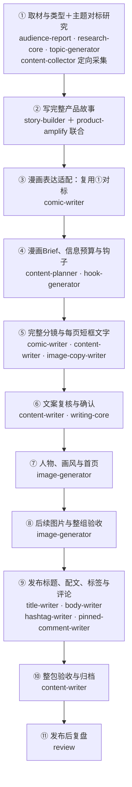

# 固定漫画全流程

漫画专属总图的唯一维护源。每轮向用户展示完整①—⑪，保持节点ID、名称和连接，每个节点必须显示实际调用的Skill及先后关系，仅在节点末尾加状态、当前位置或颜色。它追踪制作工作流，不画故事剧情，不因本轮只改封面或产品句而缩为局部图。只有完整流程发生用户确认的变化时才调整主线。

入口writing-router恢复配置，由comic-writer串联；初始化放在图外。用户从①向下阅读。产品开启时②包含联合产品写作，off时仅story-builder，不拆成两个交付节点。

comic-writer串联底座，每个节点加载主题补充。节点不新增审批；详细模块见[主文件](../SKILL.md)。①沿用雷达开关，按漫画类型与本题共同匹配同一组至少3篇对标（本轮至少1篇新增），topic-generator自行拆解、content-collector定向采集，不调用pattern-extractor。③复用①研究和②故事进行漫画表达适配，不另设一组对标；材料或深入分析缺口才按主文件定向补齐。②按本稿产品开关联合写作，⑨按平台选配套，⑪需真实数据。②内部先明确主线及信息预算、匹配功能与使用记录，再联合落笔与复核；④按实际漫画对标锁定逐页预算。

## 状态记录

在当前任务绑定的内容包或工作流记录中维护以下字段。先完整阅读再融入对应章节，不另造平行事实库。单篇事实与进度不写进通用Skill作为默认值。

| 字段 | 要求 |
| --- | --- |
| 当前细调节点 | ①—⑪的编号及正在完善的交接问题。 |
| 规则状态 | 逐节点标待细化、已写入、已部署、实稿验证中或已验证；未核验不推定。 |
| 本稿执行状态 | 未执行、已有产物待复核、进行中、缺口待补、待既有审批、完成或不适用。 |
| 依据 | 对应产物路径/文档位置、来源与批准记录；规则文件不能证明本稿完成。 |
| 下一步 | 最早缺失的必要交接、实际输出及接收模块。 |

恢复先读状态和对应产物；收尾更新记录并展示完整图，图下分别说明规则细调位置和本稿未完成项。回写失败如实报告，保留可访问的任务记录，不把未保存称为已保存。

例如⑦已有批准首页，但②整体故事未通过：保留首页，执行回到②，不把之前节点全标完成。用户指出主线或产品断链时，将故事状态退回返工，不继续沿用“底稿完成、只差加产品”的判断。
