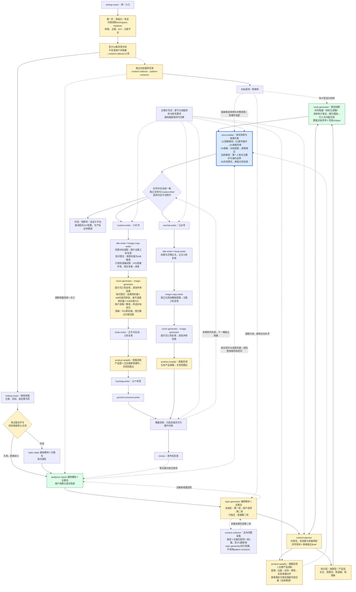

# 写作总流程与细调位置

跨平台、形式和系列篇次按[逐条制作协议](../../writing-router/references/serial-production.md)执行：内容包统一策划，每稿独立文档与Creative Brief，当前稿全部制作、审查和归档完成后才进入下一稿。下图分支表示可选路径，不能同时推进多条；发布后复盘单独记录。

本文件维护跨载体写作总图。漫画分支由 [comic-writer](../../comic-writer/SKILL.md) 串联，漫画任务每轮展示[固定漫画全流程图](../../comic-writer/references/workflow.md)，分别追踪规则细调与实稿执行；下文“唯一总图”指跨载体范围，不替代漫画专属总图。

本图是流程细调期间唯一维护的总图。状态表示规则细调进度，不表示当前文章已经生成。“已确认”只表示节点方向获确认，节点内旧参数仍须按下方待核对项区分，不能当作全部逐条获批。每轮保持节点和整体范围，更新细调位置；不以当前模块局部图替代。所有生产模块均执行“写/生成 → critique → 修改复查 → 放行”；图片文本、发布正文和出图提示词各自至少三轮，详见 three-pass-review.md。

两条分支均完整执行；指定题只跳过第一轮选题生成，第二轮调研照常完成。每个生产模块执行 critique、修改复查与放行。公众号 WX1—WX8 于2026-10-07确认为暂定固定基线；单篇内容参数仍随对标、主题与批准方案确定。

当前已落实：正文三部分规则组合；正文与评论钩子的交付结构，产品承接按篇启用并由product-amplify提供；对标逐句语气与文本结构映射；逐句四项 critique 和逐模块放行；图文互补与评论逆向提问。`hashtag-writer` 已拆分并固定10个；取消固定求赞。搜索关键词与标签的强制映射已确认，下游环节继续逐项细调。妈妈善食统一封面标准已确认，读取 pregnabite-writing 的飞书规范与标准图，不从新对标自动更换。

## 当前流程修正位置

2026-10-16当前细调入口与产品交接：writing-router按topic-overlay协议恢复，通用模块维护思考、输入输出与放行，主题包逐节点绑定业务资料。product-amplify必须读适用产品事实、承接规律、图库和使用记录，交出实际匹配与产品原句；只有读取记录不能标完成。两种第一人称承接及各稿独立Brief沿用已确认规则。此轮为规则审计与部署，故事漫画仍试行，未以规则更新代替实稿验证。

2026-10-16故事试跑纠偏：总图同步已确认的漫画例外，P01本身就是封面，不额外生成通用封面；短文本框、情景建立与人物孕期身份按story-builder/references/comic-storyboard.md执行。首页或样张完成不能代表Creative Brief、后续逐页文字或content-writer全流程完成。每步实际读取上游产物、补缺并通过原有检查后才能放行；第二轮研究未通过不得进入正式写作。已确认的首页局部形式不等于整组剩余文案获批。漫画路由仍为施工中，本次是用户明确授权的试跑，不改称ready；知识图文原路径保留。

2026-10-15当前细调S4长文：story-builder/references/first-person-longform.md将已确认的当事人视角细化为经历／写法来源分开、连续段落组织、心理与对白的来源边界、已知结尾和双形式核对；body-writer接入该协议，区分独立完整长文与漫画发布配文。既有三轮复核和平台审批继续适用；未新增固定字数、段数或审批。此为规则落实，具体长文主对标与实稿质量待首个真实故事试跑验证。

2026-10-15当前细调S4漫画：已将7组漫画对标提炼的6条候选规律、2条单条观察保存到企业库《图片规律》，并接入主题包、story-builder、image-copy-writer与image-generator。当前在story-builder/references/comic-storyboard.md细化“真实事件→对标关系适配→读者逐格获得的信息→画面／旁白／对白分工→双形式事实复核”，提供可直接填写的分镜映射格式。此为已授权规则的执行细化，候选机制尚无本账号效果验证；不新增固定画风、页格数或审批。漫画路由仍施工中，实际成图链路待真实素材试跑；第一人称长文的具体展开继续细调。

2026-10-15双形式确认：妈妈善食故事型内容包生成漫画与第一人称长文，两版共用真实孕妈经历，分别记录稿件与制作验收状态。长文以原经历孕妈为叙述者，保留真实记录整理的身份说明。规则见pregnabite-writing、story-builder与content-planner内容包协议；漫画全链路仍待细调，不因双形式要求改为ready。个人自媒体号在独立对话细调，其账号资料与专属流程分别维护，共用技能继续复用。

2026-10-15当前细调S2：用户同意继续细化真实经历的故事组织。story-builder将既有规则具体化为主线梳理、切入点选择、真实动作展开和已知结尾交接；知识建议与人物实际行为分开，素材只有片段时不补造后续。本轮未增加固定结构、数量或审批要求，实际叙事效果待真实素材试跑；S3读者所得及载体制作继续细调。

2026-10-15已落实S1：用户确认继续妈妈善食孕期故事流程，从本账号《用户洞察》中的真实孕妈经历寻找小故事来源，回查原始记录后提取触发时刻、动作、阻碍及已有后续。通用取材与证据交接见story-builder，账号范围见pregnabite-writing；个人号实践入口不作为本次默认。此为流程规则更新，尚未执行具体故事候选筛选。

2026-10-15：通用场景规则贯穿洞察、选题、Creative Brief与成稿，Pain明确触发时刻、当时动作、具体阻碍及逐项来源；真实记录、明确标注的示例、待确认设想分开。执行 research-core/references/scene-contract.md，writing-core维护写作提点，content-planner、hook-generator、body-writer、image-copy-writer与product-amplify在各自关口调用。story-builder已建立S1—S5故事方案流程，当前优化位置为P策划与S故事构建；这是规则实施，故事漫画和视频制作仍以routes.json的施工状态为准，实际成稿效果待验证。已有钩子与平台流程保留。

2026-10-12本轮：image-copy-writer、body-writer及cover-generator/image-generator提示词各自至少三轮复核，每个模块每轮重复自己的完整检查清单，统一引用 three-pass-review.md。图片保留“先原图容量与组织→拟文→再次细看原图→提示词”的顺序；超量先精简，拆页须确认；成图逐张并排验收不变。此次为规则部署，实际生产效果待后续文章验证。

2026-10-12：当前优化J图片生产节点，通用封面与A/B第二页样张展示后明确选模；每批内页检查真实选择证据、唯一整组来源与逐页结构。保持其余总流程不变。

2026-10-10当前细调：hook-generator以整篇标题、完整正文和整组图片资料为分析单位，正文中后段与图片的独立钩子、各载体配合关系进入同一协议；pattern-extractor、content-planner统一引用。妈妈善食飞书钩子库保留16条标题原话，13篇补完整正文及已有整组图片分析，22处正文原话逐条核对；B11两图、B42三图另看原图，其余明确引用已有分析。3条保留为片段线索。实际效果、候选数量与评分仍待细调。本轮不改变已确认的平台生产顺序。

2026-10-10统一分发：当前位置为 writing-router 就绪状态提示与安装验收。沿用上方同一总图；所有人共用 routes.json，小红书图文和公众号长文 ready，其余分支施工中。新分支完成后更新状态并同步即可使用。待细调清单见 ../../RELEASE-BACKLOG.md；topic-radar 延期。

2026-10-10当前：所有来源统一经audience-report写入关口使用最新规则。有增量写入与回读成功再交接，无新增记录后继续，失败保留待回写；独立对标、两轮选题、writer补查和review同样适用。协议只维护在 audience-report/references/writeback-gate.md。

2026-10-09当前细调：六维整表按通用字段标准重写，具体任务用完整自然语言、身份用人群标签、关切归核心痛点、情绪只写感受、障碍解释做不到的原因。audience-report 新增搜索栏长尾词逐词查量；六维允许基于具体处境推理情绪与关注点；实际困惑改为原话优先的自然语言记录，取消人工审核占位。唯一规则见 audience-report/references/insight-recording.md。此次整理既有资料，不代表已执行新一轮搜索。

2026-10-09：热点雷达改为可选开关，妈妈善食流程默认关闭；规则已确认。关闭后从洞察继续，热点报告不作为必备输入，旧雷达补查不自动恢复。开关唯一协议见 writing-router/references/orchestration.md。

2026-10-08当前细调：对用户统一使用writing-router；workspace-initializer只是第一步内部子模块。初始化入口、飞书/Obsidian存储映射、主题包发现、DIY覆盖、平台选择与10条对标准备门已写入规则，新的初始化尚未实机试跑。

2026-10-08已确认主线：指定题调用topic-generator第二轮，未指定题从头执行；content-research合回。按初始化选择的平台规划，content-planner按知识点、例子、依赖与载体容量拆篇。对标建库是独立工作流；单篇优先引用与定向补缺。wechat-writer为统一新名称。本轮已固定至少1篇新增对标的定向采集、通用六维方法与可选product-amplify。钩子、故事及抖音制作细则仍待细调。

### 已固定的平台分支

2026-10-07 当前修正：公众号正文先行流程固定，由 writing-router 进入 wechat-writer 的 WX1—WX8，执行其 execution.md 放行与续做规则。首篇按用户指令收尾，制作交付、发布端排版预览、实际发布分别记录；不宣称已执行发布。小红书新增 L2，位于 L Hashtag 后、M 整篇验收前。本轮先建评论对标库，具体承接形式待调研后选择，不默认固定某种引流话术。

research-core 维护通用调研，pregnabite-research 维护主题范围与资料位置，wechat-writer 维护公众号正文先行分支。资料、通用写法和模块 critique 继续引用唯一来源；两组图片候选及图片文字审批放在配图阶段。小红书的图片先行、短正文容量、20字、10个Hashtag等不自动移植。下方历史确认记录和图文逐页数量规则按其小红书作用域保留。公众号稿单独建文档，不能合并进小红书原稿。

断点继续执行 [断点恢复协议](resume-contract.md)：同时记录平台与阶段。既有小红书编号保留用于旧任务恢复，L 后新增 L2 置顶评论；公众号按 wechat-writer 的阶段恢复，不能把公众号记录为 O。历史案例的暂停记录不代表当前任务进度。

## 历史确认记录（历史单篇进度不代表当前状态）

- 2026-10-01已完成洞察链路回查：60篇图文＋7篇视频的需求记录、原对标分析需求段及问题回链均已修正；飞书《用户洞察》保留具体场景与来源，修正六维、问题卡、关键词关联及受影响方案。68篇文档回读通过，原有用户退回决定、90个关键词的指数与排序保留。`audience-report`已加入逐条原文验收与联动修正规则。此完成状态仅指洞察与对标需求链路，020稿件尚未重制。

- 2026-10-02继续纠正020结构适配：已选B16为6页，首页7项提醒、后5页各2项推荐。通用规则已固定“原图信息需求与数量→查证选材→逐页写作”，修正先写少量内容再自行减页的冲突。020飞书文案按此重写并完成结构及逐句审查，当前待用户审查图片文字；未生成新图、未完成正文，不能称整篇已完成。

- 用户明确确认且已落实：三部分规则组合、对标信息关系、两套内容、Brief末尾文字审批、正文固定三部分、逐句模仿与 critique、固定10个标签、取消固定求赞。
- 本轮新增模仿检查是对用户“标题与图片也需加强”的落实；不得声称已经通过实际写作质量测试。
- 旧参数本轮已确认：三个不同成品标题分别模仿三个不同标题对标；小红书发布标题20汉字以内归平台包；正文对标篇幅约±100字只作参考，以适中讲清主题为准；第二轮总计至少3篇，其中本轮至少新增1篇对标并完成入库（现行类型＋主题共同匹配；定向采集，topic-generator自行拆解），writer复用不重跑。
- 已确认：按现有位置和数量强制添加Emoji；采用的评论必须有评论自身的非零点赞或可核验回复，无互动不采用。
- 已确认：搜索词与Hashtag逐项对应，来源及本篇回答位置可追溯；不再重复请求确认。本轮旧参数核对结束。
- 实施细节（本轮未单独询问）：独立Skill名称、引用路径、句子ID/审查记录格式及同步方式。属于执行安排，不称为用户指定格式；不得据此要求用户填写更多表格。
- 妈妈善食封面视觉已确认并由 cover-generator 执行，唯一规范引用见 pregnabite-writing；内页仍沿用其获批方案，不能将封面模板强套全部内页。

## 全流程规则核对索引（2026-10-02）

本表指向唯一规则来源，不复制方法或账号知识。节点确认记录仍按上文区分；本次只清理已确认要求的执行冲突，不将规则检查称为实稿质量测试。

| 已确认要求 | 唯一执行来源 |
| --- | --- |
| 语义路由、通用/平台/主题组合；写作与 critique 共同使用 | content-writer 模块路由、writing-core、xiaohongshu-writing、pregnabite-writing |
| 指定题从topic-generator第二轮开始；定向研究至少3篇、至少1篇新增入库（小红书，类型＋主题共同匹配；定向采集，topic-generator自行拆解）；writer复用并定向补缺 | topic-generator；用户明确单篇豁免仅限该篇 |
| 对标分析原位保存、准确需求回写、形式分类、知识核验及正文互补 | pattern-extractor/references/benchmark-analysis.md、audience-report |
| 每篇写前实际读取已存分析；继承逐页功能、信息关系和数量，再查证选材 | image-copy-writer 前置门槛及信息需求规则 |
| A/B 独立对标与首张内容页候选；选定后仅展开所选整组 | production-review.md 两套内容方案验收 |
| 3个不同发布标题分别模仿3个来源；小红书20汉字以内；图片标题增强、人群标签 | title-writer、xiaohongshu-writing |
| 搜索词引用洞察词表；产品具体说法复核；Brief末尾全量图片文字获批后出图 | brief-approval.md |
| 样张选模后继承同一对标，剩余文案获批再出图；逐页核对 | cover-generator、image-generator |
| 正文补充图片，逐句模仿；正文与评论钩子完整；启用时含产品承接；逐句四项审查 | body-writer、writing-core、stage-critique.md |
| 评论有自身点赞/回复证据，用于补充写法与反推互动；强制Emoji、无固定求赞；恰好10个标签 | writing-core、xiaohongshu-writing、hashtag-writer |

已清理旧顺序：先写文案再定页数、先想菜再找图片、按现成密度逐页找模板、无批准自行减页；已清理固定第一篇正文结构与至少三个正文模块的要求。妈妈善食封面现执行已确认统一标准，结构复刻不自动更换账号风格。

## L2 置顶评论（2026-10-07新增）

唯一执行规则为 `../../pinned-comment-writer/SKILL.md`：先读取真实评论对标及逐句分析，再逐句对应写作和 critique；有来源、评论自身互动、完整映射及通过审查的独立草稿才进入M。与正文评论钩子分开，发布/置顶动作不自动执行。首次无库先调研入库，之后复用并补缺，研究不重复整轮选题。
