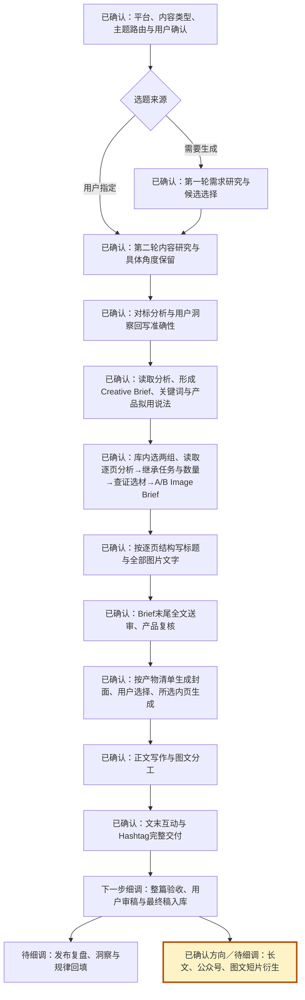

# 写作总流程与细调位置

本图是流程细调期间唯一维护的总图。状态表示规则细调进度，不表示当前文章已经生成。“已确认”只表示节点方向获确认，节点内旧参数仍须按下方待核对项区分，不能当作全部逐条获批。每轮保持节点和整体范围，更新细调位置；不以当前模块局部图替代。所有生产模块均执行“写/生成 → critique → 修改复查 → 放行”。

当前已落实：正文三部分规则组合；正文内容→产品承接→评论钩子的固定交付结构；对标逐句语气与文本结构映射；逐句四项 critique 和逐模块放行；图文互补与评论逆向提问。`hashtag-writer` 已拆分并固定10个；取消固定求赞。搜索关键词与标签的强制映射已确认，下游环节继续逐项细调。妈妈善食统一封面标准已确认，读取 pregnabite-writing 的飞书规范与标准图，不从新对标自动更换。

## 当前流程修正位置

2026-10-03 当前优化位置转到 A 的平台路由及 O 的公众号长文衍生，文章状态以飞书为准。新增 writing-router 与 wechat-writing 试行入口；公众号结构、标题、封面、篇幅与互动待细调。G—L 数量及图片顺序属于现有小红书图文路径，不作为公众号默认值。规则写入不代表公众号实稿跑通。下方为此前修正记录，不代表当前文章暂停。

2026-10-03：优化G到J的断点交接，文章生产暂停；A—O是唯一节点编号。每次续做、停止和交付执行 [断点恢复协议](resume-contract.md)，进度记录在当前飞书稿内。规则细调状态与具体文章进度分开，历史案例记录不作为当前文章进度。恢复已有调研、库内两组对标映射、审批及封面产物清单后才进入J。通用品牌封面与对标结构封面是形式，不能替代两篇独立来源。

## 确认状态复核

- 2026-10-01已完成洞察链路回查：60篇图文＋7篇视频的需求记录、原对标分析需求段及问题回链均已修正；飞书《用户洞察》保留具体场景与来源，修正六维、问题卡、关键词关联及受影响方案。68篇文档回读通过，原有用户退回决定、90个关键词的指数与排序保留。`audience-report`已加入逐条原文验收与联动修正规则。此完成状态仅指洞察与对标需求链路，020稿件尚未重制。

- 2026-10-02继续纠正020结构适配：已选B16为6页，首页7项提醒、后5页各2项推荐。通用规则已固定“原图信息需求与数量→查证选材→逐页写作”，修正先写少量内容再自行减页的冲突。020飞书文案按此重写并完成结构及逐句审查，当前待用户审查图片文字；未生成新图、未完成正文，不能称整篇已完成。

- 用户明确确认且已落实：三部分规则组合、对标信息关系、两套内容、Brief末尾文字审批、正文固定三部分、逐句模仿与 critique、固定10个标签、取消固定求赞。
- 本轮新增模仿检查是对用户“标题与图片也需加强”的落实；不得声称已经通过实际写作质量测试。
- 旧参数本轮已确认：三个不同成品标题分别模仿三个不同标题对标；小红书发布标题20汉字以内归平台包；正文对标篇幅约±100字只作参考，以适中讲清主题为准；第二轮总计至少3篇，其中本轮至少新增1篇对标并完成入库分析，writer复用不重跑。
- 已确认：按现有位置和数量强制添加Emoji；采用的评论必须有评论自身的非零点赞或可核验回复，无互动不采用。
- 已确认：搜索词与Hashtag逐项对应，来源及本篇回答位置可追溯；不再重复请求确认。本轮旧参数核对结束。
- 实施细节（本轮未单独询问）：独立Skill名称、引用路径、句子ID/审查记录格式及同步方式。属于执行安排，不称为用户指定格式；不得据此要求用户填写更多表格。
- 妈妈善食封面视觉已确认并由 cover-generator 执行，唯一规范引用见 pregnabite-writing；内页仍沿用其获批方案，不能将封面模板强套全部内页。

## 全流程规则核对索引（2026-10-02）

本表指向唯一规则来源，不复制方法或账号知识。节点确认记录仍按上文区分；本次只清理已确认要求的执行冲突，不将规则检查称为实稿质量测试。

| 已确认要求 | 唯一执行来源 |
| --- | --- |
| 语义路由、通用/平台/主题组合；写作与 critique 共同使用 | content-writer 模块路由、writing-core、xiaohongshu-writing、pregnabite-writing |
| 指定题跳过第一轮；第二轮至少3篇、至少1篇新增入库分析；writer复用并定向补缺 | topic-generator；用户明确单篇豁免仅限该篇 |
| 对标分析原位保存、准确需求回写、形式分类、知识核验及正文互补 | pattern-extractor/references/benchmark-analysis.md、audience-report |
| 每篇写前实际读取已存分析；继承逐页功能、信息关系和数量，再查证选材 | image-copy-writer 前置门槛及信息需求规则 |
| A/B 两组独立全套内容；更换整组重新适配 | production-review.md 两套内容方案验收 |
| 3个不同发布标题分别模仿3个来源；小红书20汉字以内；图片标题增强、人群标签 | title-writer、xiaohongshu-writing |
| 搜索词引用洞察词表；产品具体说法复核；Brief末尾全量图片文字获批后出图 | brief-approval.md |
| 封面选择后生成所选内页；分析、原图、获批文本与实图逐页核对 | cover-generator、image-generator |
| 正文补充图片，逐句模仿；正文、产品、评论钩子完整；逐句四项审查 | body-writer、writing-core、stage-critique.md |
| 评论有自身点赞/回复证据，用于补充写法与反推互动；强制Emoji、无固定求赞；恰好10个标签 | writing-core、xiaohongshu-writing、hashtag-writer |

已清理旧顺序：先写文案再定页数、先想菜再找图片、按现成密度逐页找模板、无批准自行减页；已清理固定第一篇正文结构与至少三个正文模块的要求。妈妈善食封面现执行已确认统一标准，结构复刻不自动更换账号风格。
